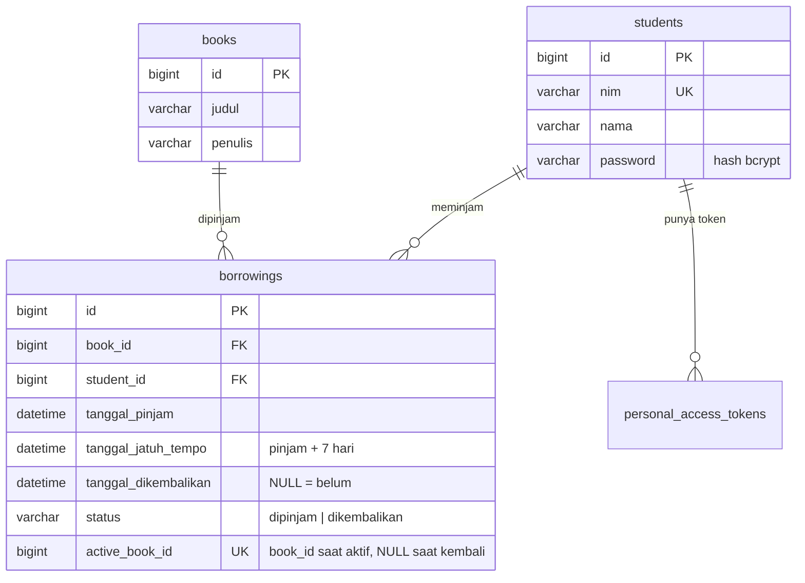

# ERD Perpustakaan API

Ketersediaan buku **tidak** disimpan di tabel `books`; dihitung dari ada/tidaknya baris `borrowings`
dengan `status = 'dipinjam'` untuk buku itu. Dengan begitu status buku tidak mungkin tidak sinkron dengan transaksi.

| Aturan | Dijaga oleh |
|---|---|
| BR-01 maks. 3 buku aktif | `BorrowingController::store` (transaksi + `lockForUpdate` pada baris mahasiswa) |
| BR-02 buku tidak tersedia tidak bisa dipinjam | cek di `store` + `UNIQUE(active_book_id)` sebagai jaring pengaman |
| BR-03 jatuh tempo = pinjam + 7 hari | `BorrowingController::store` |
